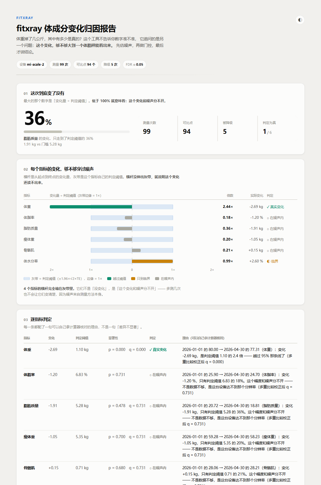

# fitxray

**在相信一个身体变化之前，先确认这个信号是不是真的。**

体脂秤每天给你二十个数字 —— 体重、体脂率、骨骼肌、体水分、基础代谢、身体年龄 ——
**没有一个告诉你这些数字的误差有多大。**

于是每个人都在做同一件事：盯着那条下行的体重曲线，把它当成减脂成果。
fitxray 做的事很简单：**把误差摆到台面上**，然后你会发现，
你引以为傲的那 0.9 kg，一直躺在噪声里。

> **我不声称我的数字准。我声称我对不确定性诚实。**

---

## 一分钟看懂它在说什么

一个 78.2 kg、体脂率 25% 的人，两个月后变成 77.8 kg、24%。

体脂秤会告诉你：**减掉了 0.878 kg 脂肪**。看着是个成果。

拿计算器跟着算一遍：

```
脂肪质量 = 体重 × 体脂率
  78.2 × 25% = 19.550 kg
  77.8 × 24% = 18.672 kg
  差          = -0.878 kg        ← 秤会把这个当成成果报给你

但 BIA 测体脂率的方法误差是 ±3 个百分点（对 DXA 的 SEE，取保守下界）
  σ(脂肪质量) ≈ 78.2 × 0.03 ≈ ±2.35 kg

0.878 / 2.35 = 37%
```

**这个变化只有它自己误差的 37%。** 完全读不出来。

关键在于：这不是"数据不够，多测几次就好了"。
**多测一百次也不会更准** —— 因为这不是随机噪声，
是 BIA 这台设备本身达不到那个分辨率。

---

## 三个主张

### ① 误差分两种，混起来会得出相反的结论

|  | 误差性质 | 多测几次 | 决定什么 |
|---|---|---|---|
| **体重** | 随机（日间波动主导） | 会收敛 | 变化检测 |
| **体脂率 → 脂肪质量** | **系统性**（BIA 方法本身的偏差） | **不会变小** | 绝对值 |

这一条是全部立论的来源。把系统性的方法误差当成随机噪声来处理
（大多数工具隐含就是这么干的），会凭空给自己加一倍的方差 ——
门槛从 2.2 kg 抬高到 6.5 kg，**真实的变化反而报不出来**。

`demos/step3_偏差为什么可以抵消.py` 把这件事算给你看。

### ② 噪声地板要从你自己的数据里估

同一台秤、同一个身体，**相邻两天的噪声**和**隔 30 天的噪声**不是一回事。
所以估的是一条随间隔变化的曲线（变差函数），不是一个常量：

```
曲线是平的  →  噪声不随间隔累积，用固定门槛
曲线在涨    →  存在生物漂移，隔得越远门槛要放得越宽
```

并且用**中位数绝对偏差**估，不用标准差 —— 否则一次生病引起的
8 kg 水分波动，会把整个噪声地板拽高 20%，工具从此变得不敢说话。

### ③ 相减之前，先问这两次测量能不能比

```
昨天早上 7:30，空腹，没运动    →  78.2 kg
今天晚上 8:00，练完腿，刚吃完饭  →  77.4 kg
```

工具会说「一天掉了 0.8 kg」。但这**两个数根本不该相减** ——
差值里混着日内波动、一顿饭、一升水，还有运动造成的肌肉水肿。

这不是噪声（噪声是随机的、会互相抵消），这是**污染**，
是系统性的、方向固定的。判据来自 ESPEN 2004 的 BIA 标准化指南和
1994 年 NIH 的技术评估会议，不是自己编的阈值。

---

## 快速开始

```bash
pip install -r requirements.txt     # 只需要 numpy + PyYAML

python run.py --synthesize          # 生成示例数据（合成，不含任何真人数据）
python run.py                       # 终端报告
python run.py --html report.html    # 自包含 HTML 报告
python run.py --evaluate            # 在已知真相的合成数据上做量化评测
```

用自己的数据：把 CSV 放进 `data/`，然后

```bash
python run.py --csv 我的记录.csv --device mi-scale-2
```

CSV 的列（除日期和两个必填项外都可选）：

```csv
date,time,weight_kg,body_fat_pct,skeletal_muscle_kg,body_water_pct,fasted,trained_8h,alcohol_8h,note
2026-01-01,07:30,78.2,25.0,33.1,55.2,true,false,false,
```

`fasted` / `trained_8h` / `alcohol_8h` 是**三态**的：真 / 假 / 留空。
留空表示"不知道"，不是"没运动" —— 这两者在判定里区别对待。
留空时会跳过相应判据，而不是假装判过了。

---

## 评测：这个东西到底准不准

这是 fitxray 和一个「阈值过滤器」拉开距离的地方 ——
合成数据带 **ground truth**，所以每个主张都能被量化。

```
python run.py --evaluate
```

| 指标 | 结果 | 说明 |
|---|---|---|
| **噪声估计准确度** | 体重 1.012 ± 0.179（87% 落在 ±25% 内）<br>体脂率 1.026 ± 0.149（97%） | 估出的 TE ÷ 实际实现的 TE，越接近 1.000 越好 |
| **可比性门控** | 注入 254 个污染点，标记 265 个<br>召回 100%，精确 96% | 宁可多标，不可漏标 —— 见下面「只降级不删除」 |
| **假阳性率** | 30 个「真值完全不动」的序列 × 6 个指标 = 180 次检验<br>不校正 **1 次误报（0.6%）** → 校正后 **0 次（0.0%）** | 一个只会说「变了」的工具没有价值 |
| **真实变化检出** | 大幅减脂（约 12 kg）：脂肪 100%、体重 100%<br>小幅减脂（约 2 kg）：脂肪 **0%**、体重 100% | 最后这一行是整个项目的结论 |

**最该看的是最后一行**：小幅减脂那组里，**15/15 个种子**都出现了
「体重判真实变化、脂肪质量判在噪声内」。

两个结论都是对的 —— 体重掉的那 2 kg 里主要是水和瘦体重，
真正想减的脂肪还埋在噪声底下。这正是普通体脂秤曲线骗人的地方：
它只画体重，你就把整条下行的线都当成了减脂成果。

---

## 报告长什么样



八张卡片：一句话结论 → 主视觉对比（变化量 ÷ 阈值，一眼看出谁穿过了噪声带）
→ 逐指标判定 → 噪声地板小倍数图 → 原始序列与噪声带 → 被降级的测量
→ 这几项不用看 → 方法边界与已知限制。

单文件 HTML，无外部依赖，浅色/深色两套配色各自验证过（不是简单反转）。

---

## 诚实的边界

**没有这一节的项目不值得信。** 以下是 fitxray 做不到的事，
以及为什么。

- **BIA 无法验证绝对值。** 本工具只对「变化」做推理，
  不声称任何单次读数准确。这恰恰是它的立场 ——
  「我不声称准确，我声称对不确定性诚实」。
- **只支持同一台设备的数据。** 跨设备比毫无意义，代码会直接拒绝。
  这不是保守，是因为 BIA 的回归公式按设备定制、厂商算法不公开，
  换一台秤就换了一套坐标系。
- **足部秤不输出 ECW/TBW。** 所有水合状态相关的判据都不适用 ——
  这是设备类型决定的，不是遗漏。
- **方法不确定度用的是文献值。** 你自己那台秤的实际误差**未知**
  （厂商不公开算法）。表里每个数字都标了出处，能查到。
- **不做诊断，不给补剂或饮食建议。** 这是刻意的边界。
  最开始我也想过做「该补什么维生素」，但那部分**没有可靠的自动化依据**，
  做出来是错的。宁可少做一个功能，也不给一个编出来的建议。
- **≥15 个可比点才做趋势判断。** 不足时明确说「数据不够」，
  不硬给结论。
- **偏差漂移处理不了。** 见 `demos/step3` 的结尾：
  稳定的偏差在相减时抵消，但**会漂的**偏差会漏进变化里，
  而且和数据无法分离（一个方程两个未知数）。只能靠测量条件
  标准化来预防，不能靠统计来事后修复。

---

## 设计里砍掉的东西

有些想法看着很聪明，做出来是错的。写在这里，免得以后又绕回去。

**❌ 自洽约束校验**（`瘦体重 ≈ 骨骼肌 + 体水分 + 骨量`）
数值上就是错的：体水分**包含在**瘦体重里面。瘦体重约 73% 是水、
20% 蛋白质、7% 矿物质；骨骼肌只占约 47%。所以
`骨骼肌 + 体水分 ≈ 1.20 × 瘦体重`，残差是 −12 kg 量级，不是 0。
更致命的是：足部秤的体水分、骨骼肌、瘦体重全都从**同一次电阻抗测量**
推出来，代进不同回归公式而已 —— 它们**不独立**。
检查它们自不自洽，检查的是设备自己公式的内部算术，不是生理真相。

**❌ 留一法归因**（到底是哪个读数错了）
`R = a − b − c`，一个方程三个未知数。调整任何一个都能让 R 归零 ——
**不可辨识**。任何"定位"都只是先点名谁就怪谁的产物。

**❌ 独立的变化点检测模块**
与本项目核心论点正交（「这 0.4 kg 下落是否在 LSC 内」不需要 CUSUM），
而在 n=20~60 的不规则单人序列上，斜率检验需要 HAC 标准误、
需要 BIC 惩罚选分段数、需要多重比较校正 —— 成本高、收益低。
降级成 `verdict.py` 内部一个带门控的小功能。

---

## 一个不太好意思的地方

这个项目的立论是「别再给我一堆数字了」。
可是判定模块自己每跑一次，就要在 6 个指标上做假设检验 ——
于是它**自己又引入了一个多重比较问题**：α=0.05 下同时看 6 个指标，
至少撞上一个假阳性的概率是 **26%**。

所以模块里显式做了 Benjamini-Hochberg 校正，并把 q 值写进报告。
`demos/step4` 用 5000 次模拟验证：不做校正误报 26.4%（理论值 26.5%），
校正后 5.3%（理论值 5%）。

**显式处理它，本身就是论点的一部分** ——
一个连自己的统计偏差都不检查的工具，没资格教别人怎么看待数字。

---

## 四步推导

`demos/` 下是四个**独立脚本**（不 import 本包，全部手写，方便逐行核对），
把结论是怎么来的推一遍：

| 脚本 | 讲什么 |
|---|---|
| `step1_两种误差.py` | 为什么体脂率的误差多测几次也不会变小 |
| `step2_噪声地板.py` | 从数据里估噪声；两个真踩过的坑 |
| `step3_偏差为什么可以抵消.py` | 为什么门槛不是那 ±2.35 kg；以及它的适用边界 |
| `step4_最后一步判定.py` | 合起来判定 + 假阳性模拟 |

```bash
python demos/step1_两种误差.py
```

---

## 项目结构

```
fitxray/
├── fitxray/
│   ├── schema.py          派生量 + 不确定度传播 + 设备误差表（带出处）
│   ├── loaders.py         读 CSV/JSONL/profile，三态布尔，附真实时间间隔
│   ├── noise.py           ★ 主张①  变差函数 + 稳健估计 → TE / LSC
│   ├── comparability.py   ★ 主张②  可比性门控（ESPEN 标准化清单）
│   ├── verdict.py         ★ 主张③  不确定度传播 + BH-FDR 校正
│   ├── synth.py           合成数据生成器（带 ground truth）
│   ├── evaluate.py        量化评测
│   ├── report.py          自包含 HTML 报告
│   └── cli.py             命令行入口
├── demos/                 四步推导（独立脚本，不 import 本包）
├── tests/                 111 个测试，离线、无网络、手工构造 fixture
├── data/                  profile.yaml + 合成数据（不含真人数据）
├── docs/screenshot.png
├── config.yaml
└── run.py
```

**依赖只有 numpy + PyYAML。** 比一般的数据/ML 项目轻得多 ——
装得快、跑得快。一个讲「别相信数字」的工具，自己不该拖进来一堆数字。

---

## 依据

不是自己编的阈值，都能查到出处：

- **ESPEN 2004** — Kyle et al., *Bioelectrical impedance analysis — part I/II*,
  Clinical Nutrition.  测量标准化条件（空腹 ≥4h、不运动 ≥8h、不饮酒 ≥8h、
  膀胱排空、固定时段、同一设备）
- **NIH 1994** — *Bioelectrical Impedance Analysis in Body Composition Measurement*,
  Technology Assessment Conference
- **Hopkins / ISAK** — 典型误差（TE）与最小显著变化（LSC = 1.96 × √2 × TE）
- **BIA vs DXA** — 体脂率 SEE 约 3.5–5 个百分点，本项目取保守下界 3.0

---

## 已知的设计取舍

- **只降级，不删除。** 把一次大幅水分波动当异常值删掉，
  等于删掉了**最该被解释的那个事件**（生病、高钠、经期）。
  所以被标记的点仍然出现在报告里，附上原因，只是不参与判定。
- **不做迭代收敛。** 用同一个估计去筛异常点、再用筛完的点更新估计，
  反复迭代会收敛到一个"看起来很干净"的结果，但那个结果的可信度
  是自我印证的。走一遍，把前后两个值都摆出来。
- **估不出就说估不出。** 可比点少于 8 个时用文献默认值，
  并在报告里明确标注「用的是默认噪声值，不是你自己的数据估出来的」。

---

## 测试

```bash
python -m pytest -q      # 111 passed
```

离线、无网络、不依赖外部数据。几个测试是**防回归**的，
锁住的是真踩过的坑，注释里写明了各自防止什么：

- `test_a_real_jump_gets_flagged` —— 突跳判据的尺度如果用全部点对去估，
  序列一带趋势阈值就飞到天上，这条判据**实际上永远不触发**

  （它在代码里、在测试里、在文档里都「存在」，只是从不出声。
  实测：120 天减脂序列上，全量估法给出 TE=2.18 kg，
  最近一档给出 TE=0.47 kg —— 门槛被抬高 4.6 倍。）
- `test_daily_gaps_all_land_in_the_first_bin` —— `_day` 带小时小数，
  "隔一天"实际是 0.96~1.04 天，把分箱代表值当边界用会把这批点劈成两箱
- `test_missing_boolean_is_none_not_false` —— 空单元格读成 `False`
  会让一条没记运动信息的记录被当成"确认没运动"
- `test_no_markdown_leaks_into_the_terminal_report` —— `**` 是给 HTML 排版用的，
  终端不认识它

---

## 许可

MIT © 宋宁涛

---

## 和 rag-xray 的关系

这是两个独立项目，放在两个仓库里。共同点是**方法**：

> **行动之前，先诊断。** `rag-xray` 是不信一个召回分数就去拆失败类型；
> `fitxray` 是不信一个体重变化就去拆它到底是不是真的。

都是「先问这个信号值不值得信，再谈它意味着什么」。
